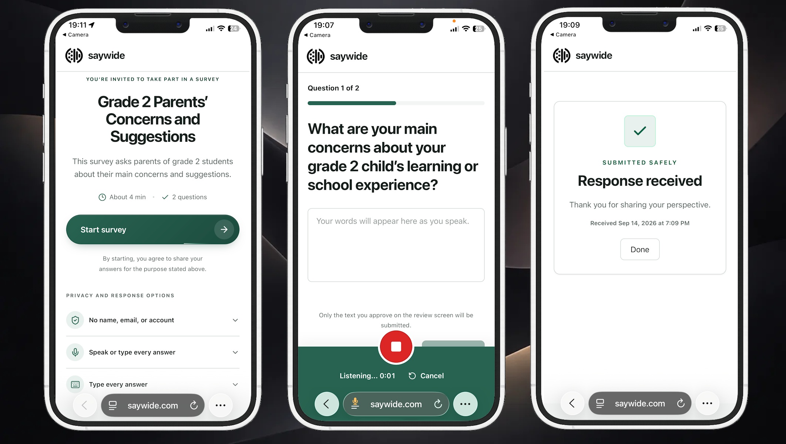
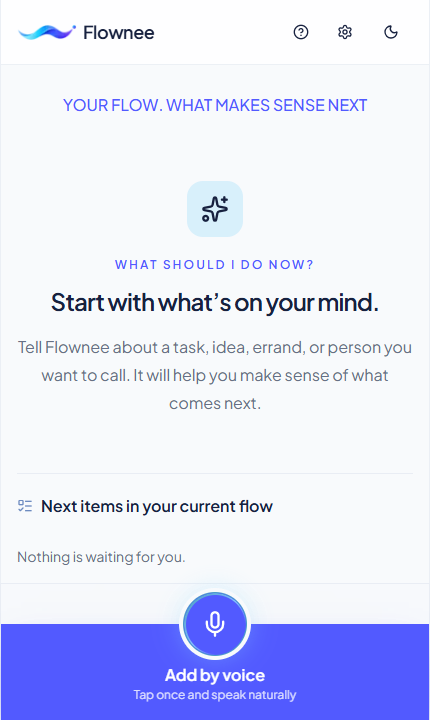

# Hi, I'm Mike 👋

<picture>
  <source media="(prefers-color-scheme: dark)" srcset="https://readme-typing-svg.demolab.com?font=Fira+Code&amp;size=20&amp;duration=3000&amp;pause=900&amp;color=58A6FF&amp;vCenter=true&amp;width=560&amp;lines=Product-minded+engineer" />
  
</picture>

👨🏽‍💻 **Full-stack developer building commerce, automation, and real-time systems with .NET, TypeScript, Web3, and modern AI tooling.** 
🤖 **I use OpenAI Codex and other AI tools for implementation, code review, debugging, and documentation.**

---

## 🛠 Tech Stack

**Backend**  

**Frontend**  

**Databases**  

**Tools**  

**Infrastructure & DevOps** 

**Blockchain / Web3**  

![Aptos](https://img.shields.io/badge/Aptos-d5fad3?style=flat-square&logo=data:image/svg+xml;base64,PHN2ZyB4bWxucz0iaHR0cDovL3d3dy53My5vcmcvMjAwMC9zdmciIHZpZXdCb3g9IjAgMCA0NzkuMyA0ODEuMiIgeG1sOnNwYWNlPSJwcmVzZXJ2ZSI+PHBhdGggZD0iTTM3MS4yIDE2MWgtNDIuNGMtNC45IDAtOS42LTIuMS0xMi45LTUuOGwtMTcuMi0xOS40Yy0yLjYtMi45LTYuMi00LjYtMTAuMS00LjZzLTcuNSAxLjctMTAuMSA0LjZsLTE0LjggMTYuN2MtNC44IDUuNC0xMS44IDguNi0xOSA4LjZIMTIuNkM2IDE3OS44IDEuNyAxOTkuNyAwIDIyMC40aDIxOS4xYzMuOSAwIDcuNS0xLjYgMTAuMi00LjRsMjAuNC0yMS4zYzIuNS0yLjcgNi4xLTQuMiA5LjctNC4yaC44YzMuOSAwIDcuNSAxLjcgMTAuMSA0LjZsMTcuMiAxOS40YzMuMyAzLjcgOCA1LjggMTIuOSA1LjhoMTc4LjhjLTEuNy0yMC42LTYtNDAuNi0xMi42LTU5LjR6TTEzMi42IDM0NS4yYzMuOSAwIDcuNS0xLjYgMTAuMi00LjRsMjAuNC0yMS4zYzIuNi0yLjcgNi4xLTQuMiA5LjgtNC4yaC44YzMuOSAwIDcuNiAxLjcgMTAuMSA0LjVsMTcuMiAxOS40YzMuMyAzLjcgOCA1LjggMTIuOSA1LjhoMjQyLjRjOS4xLTE4LjggMTUuNy0zOC45IDE5LjctNjBIMjQzLjRjLTQuOSAwLTkuNi0yLjEtMTIuOS01LjhMMjEzLjMgMjYwYy0yLjYtMi45LTYuMi00LjUtMTAuMS00LjVzLTcuNiAxLjctMTAuMSA0LjVsLTE0LjggMTYuN2MtNC44IDUuNS0xMS44IDguNi0xOS4xIDguNkgzLjNjNCAyMS4xIDEwLjYgNDEuMiAxOS43IDYwek0zMDQuNSA5Ni4xYzMuOSAwIDcuNS0xLjYgMTAuMi00LjRsMjAuNC0yMS4zYzIuNS0yLjcgNi4xLTQuMiA5LjgtNC4yaC44YzMuOSAwIDcuNSAxLjcgMTAuMSA0LjZMMzczIDkwLjNjMy4zIDMuNyA4IDUuOCAxMi45IDUuOEg0MzJDMzg4LjEgMzcuNyAzMTguMyAwIDIzOS43IDBTOTEuMiAzNy43IDQ3LjMgOTYuMXpNMjEyIDQwNC43aC02M2MtNC45IDAtOS42LTIuMS0xMi45LTUuOGwtMTcuMi0xOS40Yy0yLjYtMi45LTYuMi00LjUtMTAuMS00LjVzLTcuNiAxLjctMTAuMSA0LjVsLTE0LjggMTYuN2MtNC44IDUuNS0xMS44IDguNi0xOS4xIDguNmgtMWM0My45IDQ3IDEwNi40IDc2LjUgMTc1LjkgNzYuNXMxMzEuOS0yOS41IDE3NS45LTc2LjV6Ii8+PC9zdmc+)

**Markets**  
![MetaTrader](https://img.shields.io/badge/MetaTrader-4%20%7C%205-blue?style=flat-square&logo=data:image/svg+xml;base64,PHN2ZyB4bWxucz0iaHR0cDovL3d3dy53My5vcmcvMjAwMC9zdmciIHZpZXdCb3g9IjAgMCA0OCA0OCI+PGNpcmNsZSBjeD0iMjQiIGN5PSIyNi4xNTgiIHI9IjguMjgiIGZpbGw9Im5vbmUiIHN0cm9rZT0iI2ZmZmZmZiIgc3Ryb2tlLWxpbmVjYXA9InJvdW5kIiBzdHJva2UtbGluZWpvaW49InJvdW5kIi8+PGNpcmNsZSBjeD0iMjQiIGN5PSI5LjU5NyIgcj0iNC42NTgiIGZpbGw9Im5vbmUiIHN0cm9rZT0iI2ZmZmZmZiIgc3Ryb2tlLWxpbmVjYXA9InJvdW5kIiBzdHJva2UtbGluZWpvaW49InJvdW5kIi8+PHBhdGggZmlsbD0ibm9uZSIgc3Ryb2tlPSIjZmZmZmZmIiBzdHJva2UtbGluZWNhcD0icm91bmQiIHN0cm9rZS1saW5lam9pbj0icm91bmQiIGQ9Ik0yMC4xMDggMTguODVjLjAxLS4wODIuMDEtLjE2NS4wMS0uMjQ4di0yLjM3aDcuNzY0djIuMzdjMCAuMDgzIDAgLjE2Ni4wMS4yNDltLjc2Ni05LjI1NGE1LjE3NyA1LjE3NyAwIDAgMSA1LjE3NSA1LjE3NnYzLjgzYTIuOTcgMi45NyAwIDAgMS0yLjk0IDIuOThtLTEzLjc4NiAwYTIuOTggMi45OCAwIDAgMS0yLjk0LTIuOTh2LTMuODNhNS4xNzcgNS4xNzcgMCAwIDEgNS4xNzUtNS4xNzYiLz48Y2lyY2xlIGN4PSI5LjY1OCIgY3k9IjM0LjQzOSIgcj0iNC42NTgiIGZpbGw9Im5vbmUiIHN0cm9rZT0iI2ZmZmZmZiIgc3Ryb2tlLWxpbmVjYXA9InJvdW5kIiBzdHJva2UtbGluZWpvaW49InJvdW5kIi8+PHBhdGggZmlsbD0ibm9uZSIgc3Ryb2tlPSIjZmZmZmZmIiBzdHJva2UtbGluZWNhcD0icm91bmQiIHN0cm9rZS1saW5lam9pbj0icm91bmQiIGQ9Ik0xOS42MTcgMzMuMTgzYTIgMiAwIDAgMC0uMjIuMTE1bC0yLjA1MyAxLjE4NS0zLjg4MS02LjcyMyAyLjA1My0xLjE4NWMuMDcxLS4wNDIuMTQzLS4wODMuMjEtLjEzM20tOC4zOTcgMy45NjNhNS4xNzcgNS4xNzcgMCAwIDEgMS44OTQtNy4wN2wzLjMxNy0xLjkxNWEyLjk3IDIuOTcgMCAwIDEgNC4wNTEgMS4wNTZtNi44OTQgMTEuOTRhMi45OCAyLjk4IDAgMCAxLTEuMTEyIDQuMDM2bC0zLjMxNyAxLjkxNWE1LjE3NyA1LjE3NyAwIDAgMS03LjA3LTEuODk0Ii8+PGNpcmNsZSBjeD0iMzguMzQyIiBjeT0iMzQuNDM5IiByPSI0LjY1OCIgZmlsbD0ibm9uZSIgc3Ryb2tlPSIjZmZmZmZmIiBzdHJva2UtbGluZWNhcD0icm91bmQiIHN0cm9rZS1saW5lam9pbj0icm91bmQiLz48cGF0aCBmaWxsPSJub25lIiBzdHJva2U9IiNmZmZmZmYiIHN0cm9rZS1saW5lY2FwPSJyb3VuZCIgc3Ryb2tlLWxpbmVqb2luPSJyb3VuZCIgZD0iTTMyLjI3NCAyNi40NDJjLjA2Ny4wNS4xMzkuMDkxLjIxLjEzM2wyLjA1MyAxLjE4NS0zLjg4MSA2LjcyMy0yLjA1My0xLjE4NXEuMTA2LS4wNjUuMjItLjExNm03LjYzIDUuMjkxYTUuMTc3IDUuMTc3IDAgMCAxLTcuMDcgMS44OTRsLTMuMzE2LTEuOTE1YTIuOTcgMi45NyAwIDAgMS0xLjExMi00LjAzNm02Ljg5NC0xMS45NGEyLjk4IDIuOTggMCAwIDEgNC4wNTEtMS4wNTVsMy4zMTcgMS45MTRhNS4xNzcgNS4xNzcgMCAwIDEgMS44OTQgNy4wN20tMTUuNTY2LjI1M3YtOWwtNC44MyA2LjA0Nmg1Ljk2MiIvPjwvc3ZnPg==)

---

## 🏆 Featured Projects

### Saywide — Everyone Has Something to Say

*AI-assisted surveys that collect anonymous voice or text responses and turn community feedback into evidence-backed reports with shared priorities, supporting quotes, and suggested actions.*

  

[Live App](https://saywide.com) · [GitHub](https://github.com/landofcash/saywide.com) · [Demo Video](https://www.youtube.com/watch?v=dtRBhO6HJOA) 
🛠 `Next.js, TypeScript, Fastify, PostgreSQL, AWS Strands Agents SDK, Amazon Transcribe, OpenAI`

### Flownee — Your Flow. What Makes Sense Next

*OpenAI Build Week project — a voice-first, local-first PWA that captures everyday intentions and uses AI to recommend what makes sense next.*

  

[Live App](https://flownee-build-week.netlify.app) · [Devpost](https://devpost.com/software/flownee) 
🛠 `Next.js, React, TypeScript, Tailwind CSS, IndexedDB, PWA, OpenAI, Codex, Netlify`

---

## 🌎 Selected Projects

🔹 **[Algoosh](https://algoosh.com)** (Live app · Private source) 
*Non-custodial, escrow-based commerce protocol for physical goods & real-world delivery. Built on Algorand.*  
🛠 `React, TypeScript, Tailwind, Vite, Node.js, Algorand AVM, TealScript`

🔹 **[Aldemart](https://aldemart.com)** (Live app · Private source) 
*Decentralized marketplace for encrypted digital goods with an on-chain order lifecycle. Built on Algorand.*  
🛠 `React, TypeScript, Tailwind, Vite, C#, .NET 9, Algorand AVM, TealScript`

🔹 **[Bubble Volume Market Charts](https://landofcash.github.io/bubble-volume-market-charts/)** (Live demo · Public source) 
*Real-time Binance API crypto charts* *GitHub: [bubble-volume-market-charts](https://github.com/landofcash/bubble-volume-market-charts)* 
🛠 `Vue.js 3, Vite, Tailwind, WebSockets, Serverless`

🔹 **[QRXRQ Link Shortener](https://qrxrq.com)** (Live app · Public source) 
*URL shortening service* *GitHub: [QRXRQ Link Shortener](https://github.com/landofcash/qrxrq)* 
🛠 `React, Tailwind, Headless UI, Node.js, MongoDB, Redis, Azure CI/CD`

